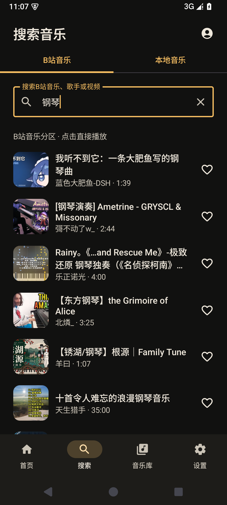
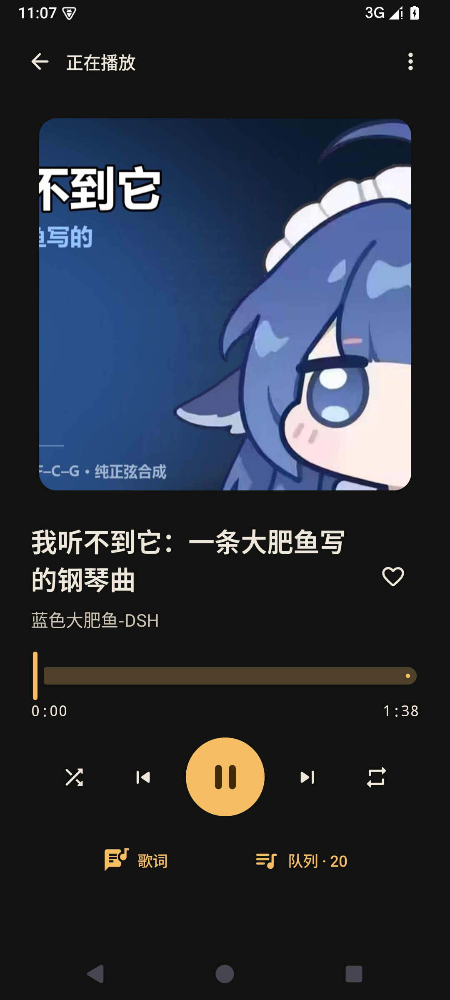

# BiliMusic

**在 BiliMusic 里搜索、播放 B站音乐。**

BiliMusic 是使用 Kotlin、Jetpack Compose 和 Media3 构建的原生 Android 音乐播放器。支持应用内搜索与音轨播放，也能管理本地音乐、歌单、收藏和 LRC 歌词。

Android 8.0+ · Material 3 · 当前版本 **0.2.0 测试版**

[安装包与版本](https://github.com/msl8489584807-blip/BiliMusic/releases) · [使用说明](docs/USAGE.md) · [构建指南](docs/BUILDING.md) · [反馈问题](https://github.com/msl8489584807-blip/BiliMusic/issues)

## 界面预览

<table>
  <tr>
    <th>应用内搜索</th>
    <th>原生音乐播放</th>
  </tr>
  <tr>
    <td></td>
    <td></td>
  </tr>
</table>

截图来自实际运行，搜索内容随平台结果变化，不在 APK 中预置。

## 功能

| 能力 | 说明 |
|---|---|
| B站音乐搜索 | 按歌名、歌手或关键词搜索音乐分区，支持分页 |
| 应用内在线播放 | 点击结果直接播放音轨，支持后台续播、切歌、进度跳转和队列 |
| 扫码登录 | 提供 B站二维码登录入口、轮询、过期刷新和本机退出 |
| B站收藏夹 | 已实现登录后读取本人收藏夹；真实账号和私有收藏夹待本人扫码验收 |
| 本地音乐 | 系统文件选择器多选导入，读取元数据与封面，URI 去重和失效文件重新关联 |
| 歌单与收藏 | 创建、重命名、排序、收藏、播放历史、分类和自定义标签 |
| 播放控制 | 迷你/完整播放器、随机、单曲/列表循环、媒体通知与睡眠定时器 |
| LRC 歌词 | 关联本地歌词、多时间戳与 offset、同步高亮、点击跳转 |
| 主题与备份 | 深浅色、跟随系统、动态配色，JSON 音乐库备份/恢复 |

没有自建账号服务器、广告或遥测。登录会话经 Android Keystore 加密后仅保存在本机，不加入音乐库备份；临时音轨地址不写入数据库。

## 安装与开始使用

1. 到仓库 [Releases](https://github.com/msl8489584807-blip/BiliMusic/releases) 下载 APK。若尚未发布安装包，可按[构建指南](docs/BUILDING.md)自行构建。
2. 安装后点击“搜索音乐”，输入关键词，再点击结果即可在应用内播放。
3. 需要登录时，打开搜索页右上角账号入口，生成二维码并在 B站扫码确认。
4. 本地音频可通过首页或音乐库的“导入音乐”加入。

当前交付文件为 `BiliMusic-0.2.0-debug.apk`，要求 Android 8.0 / API 26 以上。不同构建者的 Debug 签名可能不同，无法保证互相覆盖安装；换签名前可先备份音乐库。

详细操作见[使用说明](docs/USAGE.md)，安装包校验信息见[版本说明](releases/v0.2.0.md)。

## 构建

需要 JDK 17、Android SDK Platform 35 和 Build Tools 35.0.0。可直接在 Android Studio 中打开项目，或运行：

```powershell
# Windows PowerShell
.\gradlew.bat :app:testDebugUnitTest :app:lintDebug :app:assembleDebug
```

```bash
# macOS / Linux
bash ./gradlew :app:testDebugUnitTest :app:lintDebug :app:assembleDebug
```

APK 输出：`app/build/outputs/apk/debug/app-debug.apk`。环境配置、设备测试与依赖版本见[构建指南](docs/BUILDING.md)。

## 技术栈与结构

- **界面**：Kotlin、Jetpack Compose、Material 3、MVVM。
- **播放**：Media3 ExoPlayer、MediaSessionService、MediaController。
- **数据**：Room、DataStore、协程和 Flow。
- **网络**：Retrofit、OkHttp；二维码由 ZXing 生成。

```text
app/src/main/java/com/bilimusic/player/
├── data/           导入、备份、设置和 B站接口/会话
├── database/       Room 表、DAO 与数据库
├── domain/         BV、歌词、搜索和在线来源规则
├── playback/       播放服务、队列与控制器
└── ui/             首页、搜索、音乐库、账号和播放器
```

界面不持有 ExoPlayer。播放服务持有唯一播放器，在线曲目在队列中保存 BV/分 P 的逻辑标识，加载时解析实际音轨。

## 验证状态

0.2.0 的记录包含 **12 项单元测试**和 **21 个不同的 Android 集成用例**：完整 20 项套件通过后，增强的在线测试 5 项复测通过。已在 Android 15 模拟器验证真实搜索、原生播放、后台进度、下一首、seek 和二维码界面。

Lint 为 0 错误、20 警告。本人扫码确认后的账号、私有收藏夹，以及 One UI 锁屏、真实蓝牙/耳机和长时间播放仍待实机验证。详见[测试报告](TEST_REPORT.md)。

## 当前限制

- 在线能力依赖 B站接口、网络和当前账号的访问权限；部分内容或平台验证可能导致播放失败。
- 暂无音频下载/离线缓存、MediaStore 自动扫描、目录导入和 `b23.tv` 短链接展开。
- 备份包含音乐库元数据和设置，不含音频、封面文件、文件访问授权或账号会话。
- 尚未完成所有 Android 厂商后台与省电策略的实机适配验证。

后续计划见 [ROADMAP.md](ROADMAP.md)。反馈问题时请提供应用版本、Android 版本、设备型号与复现步骤；不要提交 Cookie、登录二维码或账号密钥。
